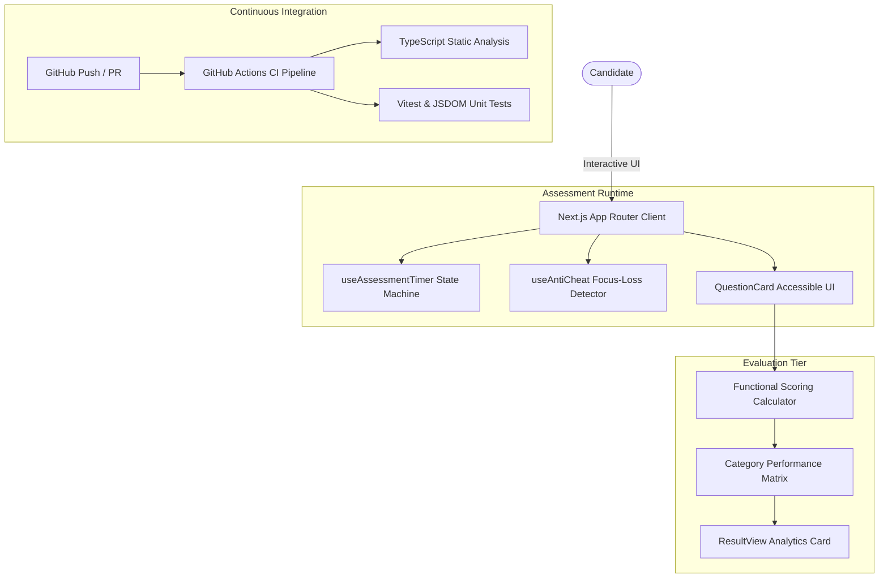

# AI-proof — Developer Technical Assessment Platform

[](https://github.com/ahmad-zayab/AI-proof/actions)


> **Live Deployment:** [aiproof-sage.vercel.app](https://aiproof-sage.vercel.app)

An interactive, anti-cheat engineering assessment engine designed to benchmark software engineers across **React.js**, **Node.js**, **TypeScript**, and **Distributed System Design**. Engineered with Next.js App Router, real-time focus-loss detection, dynamic timing state machines, and automated Vitest/GitHub Actions CI test suites.

---

## Architecture Overview



---

## Key Technical Highlights

* **Pure Functional Scoring Engine:** Decoupled scoring logic calculating overall accuracy and granular category performance across React, Node, and TypeScript.
* **Anti-Cheat Focus-Loss Detector:** `useAntiCheat` hook listening to `visibilitychange` events to prevent tab-switching during active assessments.
* **Automated CI Quality Gate:** GitHub Actions pipeline executing `tsc --noEmit` and Vitest component specs with coverage reporting on every commit.
* **Optimized Next.js Architecture:** Built with Next.js App Router, Tailwind CSS, and Radix UI primitives for sub-second page transitions.

---

## Local Development & Test Execution

### 1. Install Dependencies
```bash
npm install
```

### 2. Run Test Suite (Vitest)
```bash
npm run test
```

### 3. Run Typecheck & Lint
```bash
npm run typecheck
npm run lint
```

### 4. Start Development Server
```bash
npm run dev
```

---

## Author
**Ahmad Zayab** — Full-Stack Software Engineer
* Portfolio: [ahmadzayab.vercel.app](https://ahmadzayab.vercel.app)
* GitHub: [@ahmad-zayab](https://github.com/ahmad-zayab)
* LinkedIn: [linkedin.com/in/ahmad-zayab-26387b240](https://www.linkedin.com/in/ahmad-zayab-26387b240)
